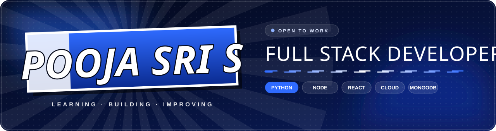

<div align="center">



<br/>

<h3>Learning. Building. Improving.</h3>

<a href="#about">ABOUT</a> &nbsp; ◆ &nbsp;
<a href="#workflow">WORKFLOW</a> &nbsp; ◆ &nbsp;
<a href="#toolkit">TOOLKIT</a> &nbsp; ◆ &nbsp;
<a href="#projects">PROJECTS</a> &nbsp; ◆ &nbsp;
<a href="#performance">STATS</a> &nbsp; ◆ &nbsp;
<a href="#contact">CONTACT</a>

<br/><br/>


</div>

<a id="about"></a>

## 💻 The Developer

```text
$ whoami
→ pooja sri s

$ cat profile.txt
role     : software developer
focus    : full-stack development · AI tools
interests: web applications · developer tools
mindset  : learning. building. improving.
base     : coimbatore, india
status   : [ ONLINE ]
```

<div align="center">

</div>

<a id="workflow"></a>

## ⚡ My Development Workflow

<div align="center">



</div>

<div align="center">

</div>

<a id="toolkit"></a>

## 🛠️ The Toolkit

**Programming Languages**

<div align="center">


</div>

**Frontend Development**

<div align="center">


</div>

**Backend Development**

<div align="center">


</div>

**Databases**

<div align="center">


</div>

**Tools & Platforms**

<div align="center">


</div>

**Libraries & Visualization**

`Plotly` &nbsp; · &nbsp; `Recharts`

**Other Technologies**

`REST APIs` &nbsp; · &nbsp; `JWT Authentication` &nbsp; · &nbsp; `Cloudinary`

**Deployment**

`Render` &nbsp; · &nbsp; `Vercel`

<div align="center">

</div>

<a id="projects"></a>


## 🚀 Featured Projects

<p align="center">
  <a href="YOUR_AI_PROJECT_REPO">
    
  </a>
  <a href="https://github.com/POOJASRI48/SpendVault">
    
  </a>
  <a href="https://github.com/POOJASRI48/asset-monitoring-system">
    
  </a>
</p>

---

## 📬 Ping Me

<p align="center">
  <a href="YOUR_LINKEDIN_URL">
    
  </a>
  <a href="mailto:YOUR_EMAIL">
    
  </a>
  <a href="https://github.com/POOJASRI48">
    
  </a>
</p>

<p align="center">
  <b>Crafting ideas into meaningful digital experiences.</b>
</p>
