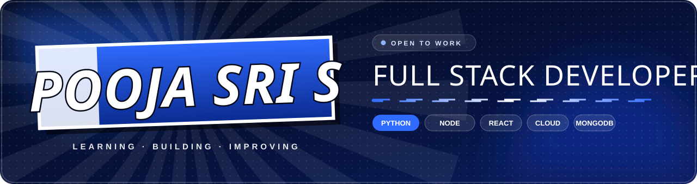

<div align="center">







</div>

## 💻 The developer

```text
$ whoami
→ pooja sri s

$ cat profile.txt
role     : full-stack builder
focus    : web apps · AI tools · problem solving
mindset  : learning. building. improving.
base     : coimbatore, india
status   : [ ONLINE ]
```

<div align="center">

</div>

## ⚙️ Under the hood

| Module | Readout |
| :--- | :--- |
| **Primary stack** | Python · JavaScript · Django · React |
| **Current mission** | Shipping full-stack and AI-powered projects |
| **Learning queue** | Next.js · PostgreSQL · Data Structures & Algorithms |

## 🗂️ The build log

| Project | Payload | Stack |
| :--- | :--- | :--- |
| **[`asset-monitoring-system`](https://github.com/POOJASRI48/asset-monitoring-system)** | Django app to track, monitor and report on organizational assets with depreciation calculation | `Django` |
| **[`collegeconnect-wa-campaigner`](https://github.com/POOJASRI48/collegeconnect-wa-campaigner)** | Streamlit dashboard to upload contacts, compose and preview WhatsApp campaigns | `Python` |
| **[`ENVISIONAI`](https://github.com/POOJASRI48/ENVISIONAI)** | AI image platform that turns text prompts into visuals you can explore and share | `JavaScript` |
| **[`LEETCODE-`](https://github.com/POOJASRI48/LEETCODE-)** | Problem-solving solutions, one commit at a time | `Python` |

<div align="center">

</div>

## 🛠️ The toolkit

<div align="center">

</div>

<div align="center">

</div>

## 📊 Performance

<div align="center">


<br />

</div>

<div align="center">

</div>

## 🐍 The commit trail

<div align="center">

</div>

<div align="center">

</div>

## 📫 Ping me

<div align="center">
<a href="https://www.linkedin.com/in/poojasri-senthilnathan"></a>
<a href="mailto:poojasenkavi@gmail.com"></a>
<a href="https://github.com/POOJASRI48"></a>
</div>

<div align="center">

</div>
