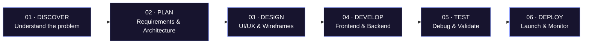

<div align="center">


</div>

## 💻 The Developer

```text
$ whoami
→ Pooja Sri S

$ cat profile.txt
role     : Software Developer
focus    : Full-stack development · AI tools
interests: Web applications · Developer tools
mindset  : Learning. Building. Improving.
base     : Coimbatore, India
status   : [ ONLINE ]
```

<div align="center">

</div>

## ⚡ My Development Workflow



<div align="center">

</div>

## 🛠️ The Toolkit

### Programming Languages

<div align="center">


</div>

### Frontend Development

<div align="center">


</div>

### Backend Development

<div align="center">


</div>

### Databases

<div align="center">


</div>

### Tools & Platforms

<div align="center">


</div>

### Libraries & Visualization

`Plotly` · `Recharts` · `REST APIs` · `JWT Authentication`

### Deployment

`Render` · `Vercel`

<div align="center">

</div>

## 📊 Performance

<div align="center">


</div>

<div align="center">

</div>

## 📫 Ping Me

<div align="center">

<a href="https://www.linkedin.com/in/poojasri-senthilnathan">

</a>

<a href="mailto:poojasenkavi@gmail.com">

</a>

<a href="https://github.com/POOJASRI48">

</a>

<br />

**Learning. Building. Improving.**

</div>
